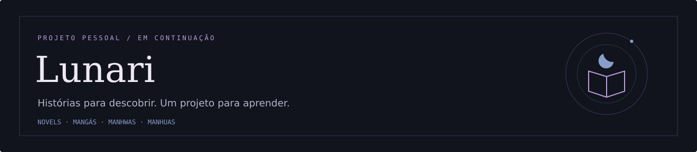

### oi, eu sou o Christian ☾

Curto Linux, animes, mangás, novels e jogos. Também gosto de ver uma ideia sair da minha cabeça e começar a funcionar na tela.

Por aqui eu exploro desenvolvimento web, inteligência artificial e automações. Ainda estou aprendendo bastante. A **Lunari** é o projeto que me faz voltar, testar mais uma coisa e descobrir outro problema pra resolver.

<picture>
  <source media="(prefers-reduced-motion: reduce)" srcset="assets/ambiente.png">
  
</picture>

#### ferramentas que passam pelo meu caminho

Uso Linux, Git, GitHub, Codex e OpenCode no meu ambiente. HTML, CSS e JavaScript aparecem neste espaço e no portfólio. Node.js, Express, SQLite e Python fazem parte da Lunari e das ferramentas que exploro com auxílio de IA.

Um lugar para encontrar uma história e continuar de onde parou. A leitura do catálogo público é livre; uma conta permite sincronizar biblioteca e progresso, além de participar da comunidade.

Eu cuido da ideia, das prioridades, das decisões, dos testes de uso e da manutenção. **Agentes de IA ajudam bastante na implementação, inclusive escrevendo código.** Não fiz tudo sozinho; entender e revisar o que construímos também faz parte do meu aprendizado.

Um pouco dos bastidores da Lunari

HTML, CSS e JavaScript no frontend; Node.js, Express e SQLite no servidor. A plataforma roda em uma VPS Linux. A produção está na 4.5.0, com atualização editorial publicada em 15/11/2026. A CLI editorial e o Laboratório Growth são ferramentas locais; o calendário de capítulos está publicado. Estado revisto em 18/11/2026. Código-fonte privado.

[Entrar na Lunari ↗](https://lunari.nautilus.host/) · [Meu portfólio ↗](https://christianarthuryag-boop.github.io/Portif-lio/) · [Novidades & conversas ↗](https://lunari.nautilus.host/forum.html)

Um espaço pessoal em construção. Pode entrar e olhar com calma.
